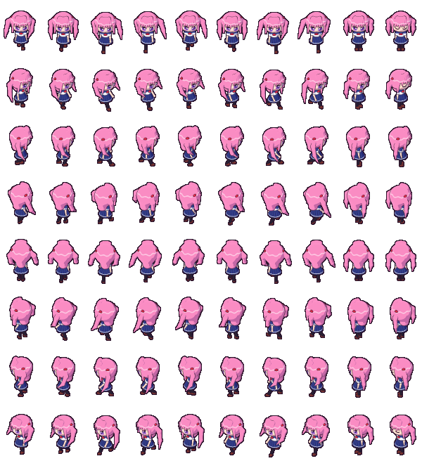

# Senpai Chase — ESP32 "Cheap Yellow Display"

> 在 ESP32 小屏幕上运行的触摸小游戏：你的像素小人跟随手指，3D 动漫女孩在樱花公园里追着你。

<!-- TODO: demo video -->



## What it does
A small touch game for the ESP32-2432S0xx "Cheap Yellow Display" (2.4"):
- a chibi sprite of me, made from a photo, follows your finger on the screen;
- a 3D anime girl, pre-rendered in 8 directions, follows the chibi;
- it all happens in a sakura park, with falling petals, hearts and speech bubbles.

## Hardware
- ESP32-2432S0xx "Cheap Yellow Display": ESP32 + ST7789 240×320 display (**BGR** order, **no** inversion), used in landscape at 320×240
- SPI on pins 14/13/12, display CS 15, DC 2, backlight 21 + 27
- XPT2046 resistive touch on the same SPI bus, CS 33

## How the code works
### Firmware (`senpai/senpai.ino`)
- **Rendering**: the 320×240 frame is drawn in 4 horizontal strips of 60 rows, with two strip buffers used in turn. While one strip is sent to the display over **DMA** (`pushImageDMA`), the CPU is already drawing the next one. Each strip is drawn in order:
  1. the background;
  2. the shadows;
  3. the sprites, with a key colour for transparency and in depth order (the one lower on screen is drawn on top);
  4. the petals, the hearts, the touch marker and the speech bubble.
- **Movement**: the chibi moves towards the touch point. The girl follows him faster the further away she is, and her direction (0–7) comes from the angle of her movement. Each direction has 8 walk frames plus idle and blink.
- **Reactions**: if the chibi gets too far away, she shouts "Aspettami senpai!". If they stand still close to each other, she says a random phrase and hearts float up.
- **Touch calibration**: on the first boot you touch three crosses. The code works out whether the X and Y axes are swapped, computes a linear mapping from raw readings to screen pixels and saves it in NVS (`Preferences`). To calibrate again, keep your finger on the screen during the startup screen.

### Asset pipeline (`tools/`, Python + NumPy + Pillow)
- `make_girl.py`: the girl is a 3D model made of signed distance functions (SDF), rendered with ray marching and cel-shading into 8 directions × 10 frames.
- `make_man.py`: turns a photo cutout (transparent PNG) into the chibi walking sprites, facing right and left.
- `export.py`: generates the background and converts every frame to RGB565, writing `senpai/assets.h` (the frames are compiled into the firmware).
- `sprites/`: all the frames as PNG files (`ragazza/dirD_walkK.png`, `idle`, `blink`; `uomo/dx_*`, `sx_*`) plus the sprite sheet.

Girl's directions: `dir0` = down (towards the viewer), then every 45° counter-clockwise on screen: `dir2` = right, `dir4` = up (back), `dir6` = left.

## Build
Requirements: Arduino ESP32 core 3.3.x, TFT_eSPI 2.5.43, partition scheme `huge_app`. The display and touch pins are passed by `build.sh` as compiler flags, so you don't need to edit TFT_eSPI's `User_Setup.h`.

```bash
# compile only
./build.sh
# compile and flash (arduino-cli path and serial port are optional)
ARDUINO_CLI=/path/to/arduino-cli PORT=/dev/ttyUSB0 UPLOAD=1 ./build.sh
```

`senpai/assets.h` is already generated, so you don't need Python to build. To regenerate it with your own sprite:

```bash
pip install numpy pillow
python tools/export.py senpai/assets.h path/to/your_cutout.png /tmp/preview
```

The original photo and its cutout aren't in the repo (`assets/` is git-ignored). Use any portrait photo with a transparent background.
