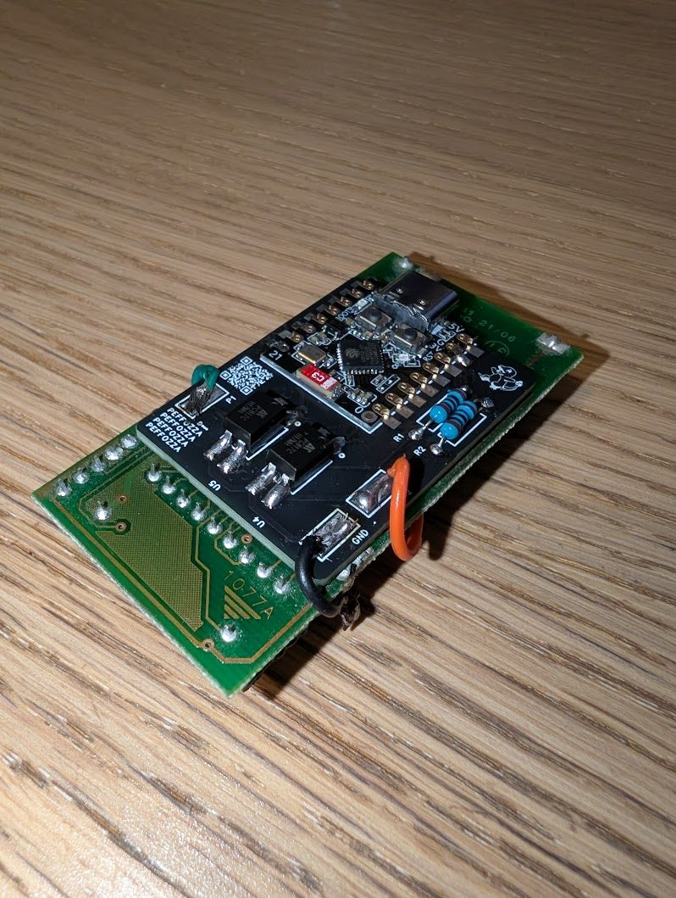

# Smart Gate — ESP32-C3 remote gate controller

> 基于 ESP32-C3 的定制 PCB，安装在原装大门遥控器上，通过 Wi-Fi 远程开门。

## What it does
A custom PCB with an ESP32-C3 that sits on top of the original gate remote and simulates its button presses. I can open the gate from my phone over Wi-Fi or the internet, and the original remote still works normally.
This was my final high-school project (ITIS Majorana, 2025), and it is still installed and working at home. I did it alone: schematic, PCB layout, soldering, firmware and testing.

## Hardware
| Ref | Part | Notes |
|---|---|---|
| ESP32-SIVALLETTO | ESP32-C3 SuperMini | Wi-Fi microcontroller module |
| U4, U5 | LITEON LTV-817S optocoupler (SMD-4) | One per remote button |
| R1, R2 | 220 Ω, 1/4 W metal film (THT) | Current limiting for the optocoupler LEDs |
| P1, P2, P3 | SMD pads | Wires to the remote: P1 and P2 go to the two buttons, P3 to the remote's common/GND |

- Board size: 43.7 × 54.9 mm, 2 layers, designed in EasyEDA Pro.

### How the circuit works
- **LED side**: two ESP32 pins drive the LEDs of the two optocouplers, U4 and U5. Each LED's current goes through its own 220 Ω resistor (R2, R1) and returns to a common pin of the module. <!-- TODO: confirm the pin numbers used (module pins 6 and 8 → which GPIOs) and that the return pin is GND -->
- **Remote side**: the phototransistor of each optocoupler is connected between a button pad (P2 for U4, P1 for U5) and P3. When the ESP32 turns on an LED, the transistor conducts and shorts that button contact to the common, just like pressing the button.
- **Isolation**: the remote's circuit (net `GND`, P3) is not connected to the ESP32's circuit, so the remote stays electrically isolated from the controller.

## Files
| Path | What it is |
|---|---|
| [`hardware/gerber/smart-gate-gerber.zip`](hardware/gerber/smart-gate-gerber.zip) | Gerber and drill files, ready to upload to JLCPCB or another PCB maker |
| [`hardware/altium/controller-cancello/`](hardware/altium/controller-cancello/) | Schematic (`P1.schdoc`) and PCB (`PCB1.pcbdoc`) exported from EasyEDA in Altium format |
| [`hardware/smart-gate-netlist.tel`](hardware/smart-gate-netlist.tel) | Netlist (Tango/Telesis format) |

<!-- TODO: add schematic and PCB screenshots (export as PNG from EasyEDA) -->

## Firmware
<!-- TODO: add the firmware code (keep Wi-Fi credentials in a git-ignored secrets.h) and explain how the phone side works (web page / app / bot) -->

## Problems I ran into
<!-- TODO -->

## What I'd do differently
<!-- TODO -->
